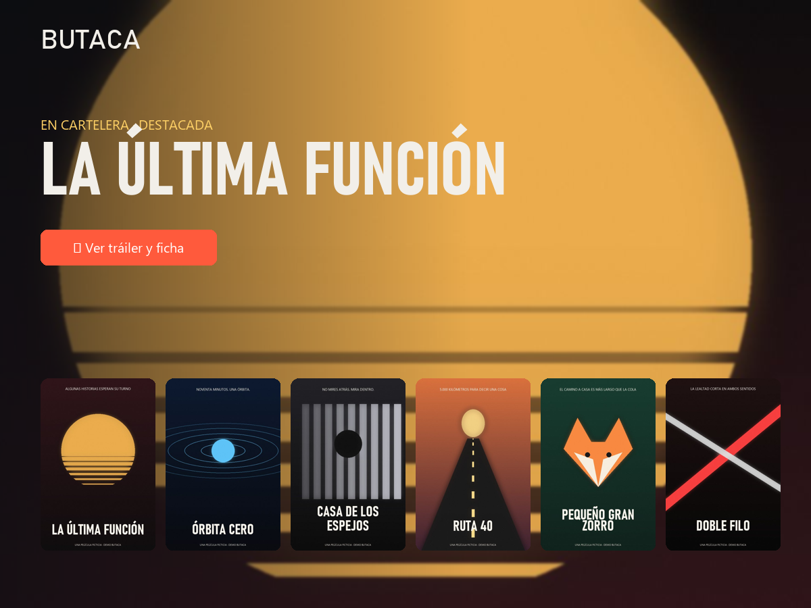

# Butaca — Tema WordPress de cartelera de cine con la API de TMDB



**Butaca** es un tema de bloques creado desde cero que convierte WordPress en un sitio de cine: muestra la **cartelera actual de tu país**, los **próximos estrenos** con cuenta regresiva, un **top de populares**, un **buscador en vivo** y **fichas completas** (sinopsis, reparto, dirección y tráiler de YouTube) en una ventana modal. Todo se alimenta de la API de [The Movie Database (TMDB)](https://www.themoviedb.org/).

### 🌐 [Ver el sitio en vivo](https://luismrojas.github.io/wp-butaca-cinema/)

¿Quieres explorar el panel de WordPress? [Abrir la demo con acceso de administrador](https://playground.wordpress.net/?blueprint-url=https://raw.githubusercontent.com/LuisMRojas/wp-butaca-cinema/main/blueprint.json)

> La demo corre en **modo demo** (sin clave de API) con 12 películas ficticias y pósters originales generados para el tema. Para ver la cartelera real, entra a **Ajustes → Butaca (TMDB)** y pega tu clave gratuita.

## Características

- **Integración con TMDB** desde PHP (`wp_remote_get`) con caché en *transients* configurable.
- **Cartelera por país** (México, España, Argentina, Colombia, Chile, Perú, EE. UU.) e idioma configurable.
- **Ficha en modal** (`<dialog>` nativo): fondo, póster, valoración, duración, géneros, dirección, reparto con fotos y **tráiler embebido** (youtube-nocookie). Enlace profundo `#pelicula-ID`.
- **Filtro por género** instantáneo sobre la rejilla, **carrusel** de estrenos con *scroll-snap* y **ranking** numerado.
- **Buscador en vivo** con *debounce* contra la API.
- **API REST propia** (`/wp-json/butaca/v1/pelicula/{id}`, `/buscar?q=`, `/lista/{lista}`): la clave **nunca** llega al navegador.
- **Modo demo y tolerancia a fallos**: sin clave, o si TMDB no responde, se muestra un catálogo local para que el sitio nunca quede vacío. Los administradores ven un aviso con el motivo.
- **Página de ajustes** con prueba de conexión, selector de idioma/país, duración de caché y botón para vaciarla. También admite la constante `BUTACA_TMDB_KEY` en `wp-config.php`.
- Valoración en anillo con `conic-gradient`, accesible con teclado y respeta `prefers-reduced-motion`.

## Shortcodes

| Shortcode | Resultado |
| --- | --- |
| `[butaca_destacada lista="now_playing"]` | Portada con la película destacada |
| `[butaca_cartelera lista="now_playing" cantidad="12" filtros="si"]` | Rejilla de pósters con filtros |
| `[butaca_carrusel lista="upcoming" cantidad="10"]` | Carrusel de estrenos con cuenta regresiva |
| `[butaca_ranking lista="popular" cantidad="5"]` | Top numerado |
| `[butaca_buscador]` | Buscador en vivo |

Listas: `now_playing`, `upcoming`, `popular`, `top_rated`. Todos están disponibles también como **patrones de bloque** (categoría *Butaca · Cine*).

## Instalación

1. Descarga el repositorio como ZIP y súbelo en **Apariencia → Temas → Añadir nuevo → Subir tema**. Activa **Butaca**.
2. Crea una cuenta gratis en TMDB y copia tu clave en [themoviedb.org/settings/api](https://www.themoviedb.org/settings/api).
3. Pégala en **Ajustes → Butaca (TMDB)** (o añade `define( 'BUTACA_TMDB_KEY', 'tu-clave' );` a `wp-config.php`).
4. Elige país e idioma. ¡Listo!

Requisitos: WordPress 6.5+ y PHP 7.4+.

## Arquitectura

```
butaca/
├── functions.php        # Carga módulos, assets, filtros
├── inc/
│   ├── tmdb.php         # Cliente TMDB, caché, normalización y modo demo
│   ├── rest.php         # Endpoints REST del tema
│   ├── render.php       # Shortcodes y modal
│   └── settings.php     # Ajustes → Butaca (TMDB)
├── assets/js/butaca.js  # Modal, filtros, carrusel, buscador (vanilla JS)
├── assets/css/butaca.css
├── demo/                # Catálogo ficticio + pósters originales
├── parts/ templates/ patterns/
└── blueprint.json       # Demo en WordPress Playground
```

```
Navegador ──► /wp-json/butaca/v1/... ──► inc/tmdb.php ──► caché (transients) ──► api.themoviedb.org
                                                    └──► demo/movies.json (sin clave o error)
```

## Créditos


This product uses the TMDB API but is not endorsed or certified by TMDB. Las películas del modo demo son ficticias y sus pósters fueron generados para este proyecto. Tipografías Bebas Neue e Inter (OFL).

## Licencia

GPL-2.0-or-later.
